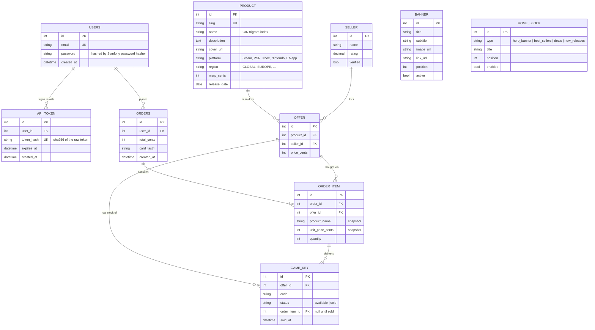

# PLAN.md: Eneba marketplace

Deadline: **2026-11-16**. Part-time work, about 2 days. Every decision and its reason is in [Decisions](#decisions).

## 1. Scope and priorities

All 7 required parts are built. Depth goes to the purchase flow. Everything else stays minimal but works.

**If time runs short, this is the priority order (top = protected last):**
1. Deployed and working end to end (Vercel + Render + Neon).
2. Search: typo tolerance and a live dropdown in the header.
3. Product page: offers from several sellers, easy to compare.
4. Checkout delivers a digital key (simulated payment, no key sold twice).
5. Store page: filters for platform, region and price, plus sort and pagination.
6. Homepage blocks.
7. Visual polish and responsiveness.

| Area | Level | Why |
|---|---|---|
| Search (header dropdown + store) | **Deep** | Used on every screen and an explicit requirement for typos and partial names. |
| Product page + offers | **Deep** | It's the core of a marketplace: comparing sellers. |
| Cart → checkout → key | **Deep** | It's the end of the purchase flow and has a real correctness problem (no double-sold keys). |
| Auth | Solid but small | Register, login, logout, token expiry. No email verification or password reset. |
| Store | Medium | 3 filters + sort + pagination. No type or OS filters. |
| Homepage | Medium | 3–4 blocks, each from its own provider and source. The architecture matters more than the visuals here. |
| Styling | Eneba look on desktop | Colors, fonts and components follow the screenshots. Mobile gets basic responsiveness only. |

**Cut (listed in the README with reasons):** wishlist, categories mega-menu, language/currency switcher, reviews and ratings, cashback, seller pages, email verification, password reset, rate limiting, real payments, pixel-perfect mobile, admin panel.

## 2. Architecture

```
Browser ── React SPA (Vercel) ──HTTPS/JSON──> Symfony REST API (Render, Docker) ──> PostgreSQL (Neon)
                                  CORS + Bearer token
```

- **Monorepo:** `/frontend` and `/backend` in one GitHub repo, deployed separately.
- **Frontend:** Vite + React + TypeScript, React Router, CSS Modules + `tokens.css`. Data comes through one `api.ts` wrapper (base URL from `VITE_API_URL`, adds `Authorization: Bearer`, turns error JSON into thrown errors) and small hooks (`useFetch`, `useDebounce`, `useAuth`, `useCart`). The frontend holds no product, block or filter data. Everything comes from the API.
- **Backend:** Symfony 7.4 LTS on PHP 8.4. Thin controllers (like ASP.NET controllers) call services that are registered via autowiring (like ASP.NET Core DI). Doctrine ORM handles entities and migrations (like EF Core). Native SQL through Doctrine DBAL is used only where Postgres-specific features are needed (pg_trgm, `FOR UPDATE SKIP LOCKED`). Request bodies are mapped into DTOs with `#[MapRequestPayload]` and checked by the validator (like `[FromBody]` + DataAnnotations).

### Repo structure
```
backend/
  src/Controller/      Home, Product, Search, Auth, Checkout, Order, Health
  src/Entity/          User, ApiToken, Product, Seller, Offer, GameKey, Order, OrderItem, Banner, HomeBlock
  src/Repository/
  src/Home/            BlockProviderInterface.php, Provider/{HeroBanner,BestSellers,Deals,NewReleases}Provider.php
  src/Search/          ProductSearch.php            (pg_trgm queries)
  src/Checkout/        CheckoutService.php, PaymentSimulator.php
  src/Security/        ApiTokenHandler.php          (Symfony access_token authenticator)
  src/Command/         SeedCommand.php              (app:seed --if-empty)
  migrations/
  Dockerfile, docker/start.sh
frontend/
  src/api/             client.ts, types.ts
  src/hooks/           useFetch, useDebounce, useAuth, useCart
  src/components/      Header, SearchBox, ProductCard, OfferRow, Footer, Price, ImageWithFallback …
  src/home-blocks/     registry: block type → component (HeroBanner, ProductRow)
  src/pages/           Home, Store, Product, Cart, Checkout, Orders, OrderDetail, Login, Register
  src/styles/          tokens.css, global.css
  vercel.json          (SPA rewrite to index.html)
docs/  PLAN.md  README.md  CLAUDE.md  .gitattributes
```

### Homepage blocks: each from its own source
- The `home_block` table holds the layout (`type`, `title`, `position`, `enabled`).
- Each block type has a provider class that implements `BlockProviderInterface` (`supports(type)`, `provide(block)`). Providers are collected through a tagged iterator, like injecting `IEnumerable<IBlockProvider>` in .NET.

| Block | Provider | Data source |
|---|---|---|
| Hero banner | `HeroBannerProvider` | `banner` table (marketing content) |
| Best sellers | `BestSellersProvider` | aggregated `order_item` sales |
| Deals | `DealsProvider` | `offer` prices vs product MSRP (biggest discount) |
| New releases | `NewReleasesProvider` | `product.release_date` (catalog). Cut first if time is short. |

- The frontend calls `GET /api/home` (layout only), then calls `GET /api/home/blocks/{id}` once per block. Each block has its own loading skeleton and its own error state, so one failing provider doesn't break the page.

## 3. Data model



Notes: money is stored as integer cents in EUR (no float rounding). Stock = the number of `available` keys on an offer. A product's "From" price = its cheapest offer that still has stock. The seed creates about 50 products, 8 sellers, 2–5 offers per product, a few keys per offer, banners, the block layout and some past orders so the best-sellers block isn't empty.

Table names: `users` and `orders` (not `user` / `order`), because both are reserved words in PostgreSQL and would need quoting in every native SQL query. The PHP entities are still `User` and `Order`.

Constraints beyond the diagram:
- `offer`: unique `(product_id, seller_id)`, so a seller lists a product only once.
- `game_key`: unique `code`, and an index on `(offer_id, status)` for the checkout query that picks available keys.
- `game_key.status` is a PHP backed enum (`KeyStatus`), stored as a string.
- `seller.rating` is `numeric(3,2)`.
- `api_token.user_id` uses `ON DELETE CASCADE`.

Demo account (created by the seed, listed in the README): `demo@example.com` / `demo12345`. It already has 3 past orders.

## 4. REST API

All JSON uses camelCase. Errors look like `{ "error": { "code": "validation_failed", "message": "...", "fields": { "email": "..." } } }` with a matching HTTP status (400/401/402/404/409/422). 🔒 = needs `Authorization: Bearer <token>`.

| Method & path | Params / body | Response |
|---|---|---|
| `GET /api/health` | none | `{ status: "ok" }` (used for deploy checks and warm-up pings) |
| `GET /api/home` | none | `{ blocks: [{ id, type, title }] }` |
| `GET /api/home/blocks/{id}` | none | `{ id, type, title, items: Banner[] \| ProductCard[] }` |
| `GET /api/products` | `q`, `platform[]`, `region[]`, `minPrice`, `maxPrice` (cents), `sort` = `popular\|price_asc\|price_desc\|discount\|newest`, `page`, `limit` (≤48, default 24) | `{ items: ProductCard[], total, page, pages }` |
| `GET /api/products/filters` | none | `{ platforms: [{ value, count }], regions: [{ value, count }], price: { minCents, maxCents } }` |
| `GET /api/products/{slug}` | none | `ProductDetail` (with `offers: Offer[]` sorted by price, cheapest first) |
| `GET /api/search/suggest` | `q` (≥2 chars) | `{ items: ProductCard[] }` (max 8) |
| `POST /api/cart/quote` | `{ items: [{ offerId, quantity }] }` | `{ lines: [{ offer, product, quantity, lineTotalCents, available }], totalCents }` |
| `POST /api/auth/register` | `{ email, password }` (password ≥ 8 chars) | `201 { token, expiresAt, user }` |
| `POST /api/auth/login` | `{ email, password }` | `200 { token, expiresAt, user }` / `401` |
| `POST /api/auth/logout` 🔒 | none | `204` (deletes the token) |
| `GET /api/me` 🔒 | none | `{ id, email }` |
| `POST /api/checkout` 🔒 | `{ items: [{ offerId, quantity }], card: { number, expiry, cvc, name } }` | `201 Order` (with keys) / `402 card_declined` / `409 out_of_stock` |
| `GET /api/orders` 🔒 | none | `{ items: OrderSummary[] }` |
| `GET /api/orders/{id}` 🔒 | none | `Order` with keys (`404` if it isn't the caller's order) |

Shapes:
- `ProductCard = { id, slug, name, coverUrl, platform, region, fromPriceCents, msrpCents, discountPercent, offerCount }`
- `ProductDetail = ProductCard + { description, releaseDate, offers }`
- `Offer = { id, priceCents, stock, seller: { id, name, rating, verified } }`
- `Banner = { id, title, subtitle, imageUrl, linkUrl }`
- `Order = { id, createdAt, totalCents, cardLast4, items: [{ productName, unitPriceCents, quantity, keys: string[] }] }`

## 5. Search

- A migration enables `CREATE EXTENSION pg_trgm` and adds a GIN index `gin_trgm_ops` on `lower(name)`.
- The query runs as native SQL in `ProductSearch`: it matches when `lower(name) ILIKE '%' || q || '%'` (partial names) **or** when `q <% lower(name)` (word similarity, which handles typos such as "minecarft" or "cyberpnk"). Ordering: prefix matches first, then by `word_similarity` descending, then by popularity. The word-similarity threshold is **0.5**, tuned against the typo list in `ProductSearchTest` (Decision 18). It is set per query with `set_config(..., true)` inside a transaction.
- The same function backs `/api/search/suggest` (top 8) and the `q` filter in `/api/products`, so the dropdown and the store always agree.
- **Dropdown (header, on every page):** 250 ms debounce, `AbortController` cancels outdated requests, results show cover, name, platform/region and "From" price. Keyboard: ↑/↓/Enter/Esc. "See all results" goes to `/store?q=…`. Empty and error states are handled.

## 6. Auth

- Symfony's built-in `access_token` authenticator with a custom `ApiTokenHandler`. No extra bundle.
- On login or register: generate 32 random bytes, return the raw token **once**, and store only its `sha256` hash with `expires_at` (7 days). The handler hashes the incoming token, looks it up, and rejects it if missing or expired.
- Passwords are hashed with Symfony's `UserPasswordHasherInterface` (`auto` = bcrypt/argon2id), similar to ASP.NET Identity's `PasswordHasher`.
- Logout deletes the token row, so the token is revoked right away.
- Frontend: the token is kept in `localStorage`, `AuthContext` exposes `user` / `login` / `logout`, and `<RequireAuth>` sends guests to `/login?next=…` before checkout, orders and order details.
- `security.yaml`: `^/api/(checkout|orders|me|auth/logout)` require `ROLE_USER`. Everything else is public.

## 7. Cart, checkout and payment

- **Cart** lives in `localStorage` as `[{ offerId, quantity }]` only. The cart page calls `POST /api/cart/quote` to show real prices and stock from the backend. The browser is never trusted for prices.
- **Payment simulation** (`PaymentSimulator`): a basic check of card format and expiry. `4242 4242 4242 4242` succeeds, `4000 0000 0000 0002` returns `402 card_declined`. Only the last 4 digits are stored.
- **Checkout (`CheckoutService`), all in one DB transaction:**
  1. Reload offers and prices from the DB.
  2. For each line: `SELECT id FROM game_key WHERE offer_id = :offer AND status = 'available' ORDER BY id LIMIT :qty FOR UPDATE SKIP LOCKED`. If fewer rows come back than requested, roll back and return `409 out_of_stock`.
  3. Create the `orders` and `order_item` rows (price snapshots).
  4. `UPDATE game_key SET status='sold', order_item_id=…, sold_at=now() WHERE id IN (…) AND status='available'`, and check that the number of affected rows equals what was requested (a second safety net).
  5. Commit and return the order with its keys.
- `FOR UPDATE` locks the chosen key rows, so two checkouts running at the same time can never take the same key. `SKIP LOCKED` makes the second checkout take the *next* free keys instead of waiting.
- After a successful checkout the frontend clears the cart and goes to `/orders/{id}`, where the keys are shown with copy buttons.

## 8. Database and hosting

| Piece | Where | Notes |
|---|---|---|
| PostgreSQL | **Neon** free | Doesn't expire. pg_trgm is supported. `DATABASE_URL` is set as a Render env var. |
| API | **Render** free web service, Docker (`php:8.4-apache` + `pdo_pgsql`) | It sleeps after 15 min idle (about 1 min to wake). Free Render has no shell, so `start.sh` runs `doctrine:migrations:migrate --no-interaction` and `app:seed --if-empty` on every boot (both are idempotent). |
| Frontend | **Vercel** | `VITE_API_URL` env var. `vercel.json` rewrites routes to `index.html` for React Router. |
| CORS | `nelmio/cors-bundle` | The allowed origin comes from the `CORS_ALLOW_ORIGIN` env var, and the `Authorization` header is allowed. |

Secrets (`DATABASE_URL`, `APP_SECRET`) live only in env vars and git-ignored `.env.local`. `.env` holds placeholders. `.gitattributes` forces LF for `*.sh` and `Dockerfile`.
Cold start: the frontend shows a "Waking up the server…" notice if the first request takes more than 3 s. An optional free uptime ping hits `/api/health` every 10 min (750 free hours/month covers one service 24/7). The README mentions the cold start.

## 9. New packages (approved together with this plan)

- **Backend (Composer):** `symfony/skeleton`, `symfony/orm-pack` (Doctrine ORM, DBAL, migrations), `symfony/security-bundle`, `symfony/validator`, `symfony/serializer-pack` (for `#[MapRequestPayload]`), `nelmio/cors-bundle`. Dev only: `symfony/maker-bundle` (code generators), `symfony/test-pack` (PHPUnit + Symfony test helpers, like xUnit + `WebApplicationFactory` in .NET), used for the two tests in §10. The tests run against a separate local Postgres test database (`DATABASE_URL` in `.env.test.local`).
- **Frontend (npm):** Vite React-TS template (`react`, `react-dom`, `typescript`, `vite`), `react-router-dom`.

Anything else gets asked about first.

## 10. Build order

Each step is one or more small commits. Hours are rough estimates.

**Sat 14 Nov (rest of today), about 3 h**
1. Commit PLAN.md. Add `.gitattributes`.
2. Scaffold `backend/` (Symfony) and `frontend/` (Vite). Add `GET /api/health` and CORS (nelmio), because the local frontend can't call the API without it. Frontend page calls it.
3. **Deploy the empty skeleton**: create the Neon DB, the Render Docker service and the Vercel project, and set up CORS. Check that the Vercel page shows "API ok". *(This handles the biggest risk first.)*

**Sun 15 Nov, about 5–6 h**
4. Entities + migration (including pg_trgm and the index) + `app:seed`.
5. Frontend shell: `tokens.css`, Header (logo, search box, cart, login), Footer, routes, `api.ts`.
6. Search: `ProductSearch`, `/api/search/suggest`, header dropdown. On mobile, the full-width search bar becomes a search icon in the header row that opens it, like eneba.com (lowest priority, with the rest of the mobile polish).
7. **Test: search.** `ProductSearchTest` runs a fixed list of typos and partial names (e.g. "minecarft", "cyberpnk", "witcher", "gta") against the seeded test database and asserts the expected product is in the results.
8. Product page: `/api/products/{slug}` and the offers comparison UI. Add to cart.
9. Auth: `User` and `ApiToken`, register/login/logout/me, `AuthContext`, login and register pages.

**Mon 16 Nov, about 5–6 h**
10. Cart page + quote, checkout page + `CheckoutService` + simulated payment, order page with keys, order history.
11. **Test: checkout.** `CheckoutServiceTest`: (a) the same key is never sold twice: buying all of an offer's keys, then buying again, gives no duplicate key codes across orders; (b) the out-of-stock case: asking for more keys than are available returns `409 out_of_stock` (through `POST /api/checkout`), and no order or key change is saved.
12. Store page: `/api/products` with filters, sort and pagination, plus `/api/products/filters`.
13. Homepage: `home_block`/`banner`, providers, block endpoints, block components.
14. Styling pass against the screenshots, basic responsive layout, loading/error states.
15. README (setup, how to run the tests, live URL, cut features with reasons, image credits, cold-start note). Export the AI logs. Final deploy and a full click-through.

If behind schedule, drop items from the bottom of the priority list in §1 (New-releases block first, then mobile polish, then store sort options beyond price and popular).

## 11. Main risks

| Risk | Mitigation |
|---|---|
| Docker/PHP deploy on Render fails (new stack for the author) | Deploy the empty skeleton on day 1 (step 3). |
| Render cold start makes reviewers think the app is broken | "Waking up" notice, uptime ping, README note. |
| Not enough time | Strict priority order, small commits, cuts written in the README. |
| pg_trgm threshold too strict or too loose | `ProductSearchTest` checks a fixed list of typos and partial names. Tune the threshold until it passes. |
| CORS / `Authorization` preflight errors | Set up nelmio on day 1 and test from the Vercel URL. |
| Same key sold twice | `FOR UPDATE SKIP LOCKED` + a conditional `UPDATE` with a row-count check, all in one transaction. Covered by `CheckoutServiceTest`. |
| Hotlinked cover images break | Use stable image URLs plus an `<ImageWithFallback>` generated placeholder. |
| Free Render has no shell for migrations/seeding | Run idempotent migrate + seed in `start.sh`. |
| Learning PHP/Symfony while building | Stick to standard Symfony patterns, explain each concept with a .NET comparison. |

## Decisions

| # | Decision | Reason |
|---|---|---|
| 1 | **REST** over GraphQL | Simpler, and I have worked with REST before. |
| 2 | **PostgreSQL** | pg_trgm handles typos and partial names inside the database, so search doesn't need an extra service. I've used it before and free hosted Postgres options exist. |
| 3 | **Vercel (frontend) + Render (API, Docker) + Neon (DB)** | I've used Vercel and Render before. The frontend loads instantly. Render's 30 s–1 min wake-up is known and accepted. Neon doesn't expire, unlike Render's free Postgres. CORS setup is an acceptable cost. Supabase was considered, but I have no free project slots left there. |
| 4 | **Search with Postgres pg_trgm** | No extra service or sync. Handles typos (trigram similarity) and partial names (ILIKE). It's one SQL query to explain. Meilisearch/Algolia would be too much for 2 days. |
| 5 | **Symfony built-in access tokens** | Built in, works across domains, and logout revokes the token. Tokens expire, only a hash is stored in the DB, and passwords use Symfony's password hasher. |
| 6 | **Scope: deep purchase flow** | Priorities: deployed end to end > search with typos + dropdown > product offer comparison > checkout delivering a key. Homepage polish and responsiveness come last. Cut features are listed in the README with reasons. |
| 7 | **Simulated payment** | Stripe test mode is too big for the deadline. The same key can never be sold twice: key rows are locked inside the checkout transaction. |
| 8 | **Homepage: one provider per block** | Each block has its own provider and data source, and blocks load and fail independently. Separate microservices would be the most literal reading, but they aren't realistic in 2 days on a free tier. |
| 9 | **Seed data: hand-written titles + stable cover URLs** | Looks like Eneba. A generated placeholder is shown if an image fails to load. The README notes that images belong to their owners. |
| 10 | **CSS Modules + design tokens** | Built into Vite, so no extra library. Plain CSS is easy to explain. |
| 11 | **Plain `fetch` + small hooks** | No data-fetching library. Every line is ours to explain. |
| 12 | **Cart in localStorage, priced by the backend** | Guests can build a cart like on Eneba. Only offer IDs and quantities are stored. The backend reloads prices and stock, so no cart tables are needed. |
| 13 | **Monorepo, money in integer cents, Symfony 7.4 LTS** | One repo to submit. Integers avoid float rounding errors. LTS has the most documentation. |
| 14 | **Local Postgres via Docker Compose** (`backend/compose.yaml`, `postgres:17-alpine`) | Docker is already installed. Same major version as Neon, and pg_trgm is included. One container holds both `app` and `app_test` (Doctrine adds the `_test` suffix in the test env). `docker compose down -v` gives a clean reset. A native Windows install is heavier and hard to reset. Neon branches for dev/tests need internet and make tests slow and flaky. |
| 15 | **No Symfony CLI** | One less tool to install. PHP's built-in server (`php -S localhost:8000 -t public`) and Composer cover everything, and they're easier to explain. |
| 16 | **`users` table name** (not `user`) | `user` is a reserved word in PostgreSQL, so every native SQL query would need `"user"` in quotes. This matches `orders`. |
| 17 | **Seed is deterministic, all-or-nothing, never overwrites** | A fixed random seed gives every environment (local, test, Neon) the same data, so the search test can rely on it. One transaction means a crash leaves the DB empty and the next boot retries. `--if-empty` skips when products exist. Without the flag, the command refuses to run on a non-empty DB. Demo user `demo@example.com` / `demo12345` so reviewers can sign in right away. |
| 18 | **Search word-similarity threshold 0.5** | Measured on the seed. Postgres's default of 0.6 misses "minecarft" (0.50). 0.4 would add "wticher" (0.40), but also irrelevant hits for games we don't sell: halo → Hades, fifa → Split Fiction, sims → Sid Meier's. 0.3 adds wrong games to real queries ("eldn ring" also returns Skyrim). Known cost at 0.5: "mario" → Marvel's Spider-Man (also exactly 0.50). The test checks both directions. |
