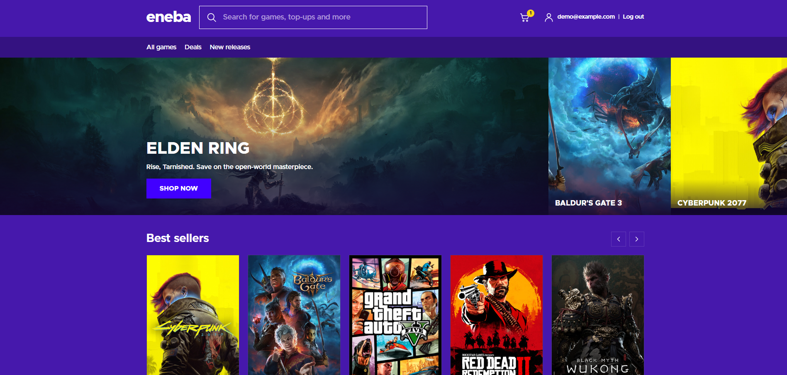
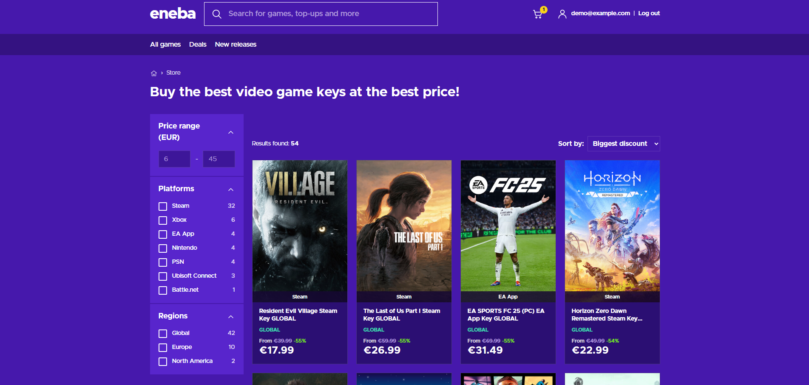
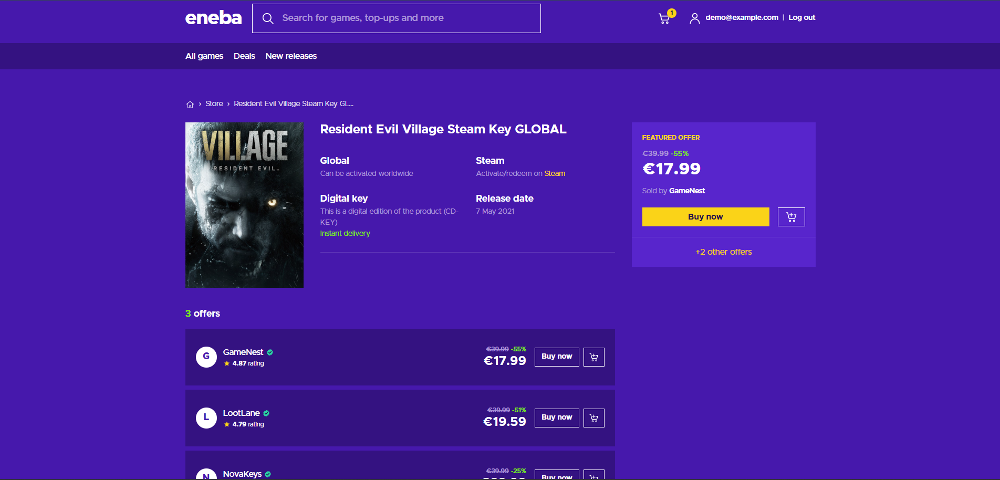
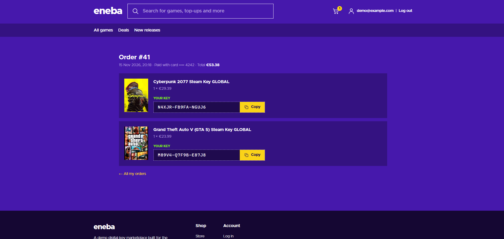
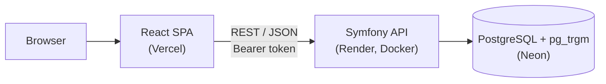

# Eneba-style Game Key Marketplace

A digital game-key marketplace with typo-tolerant search, multi-seller offers and a concurrency-safe checkout.
Built as a take-home assignment for the Eneba 2027 internship.

**[Live demo](https://eneba-marketplace-three.vercel.app)** · **[PLAN.md](PLAN.md)** (scope, architecture, 36 decisions) · **[AI logs](docs/ai-logs/)**



## Live demo

| | |
|---|---|
| App | https://eneba-marketplace-three.vercel.app |
| API health check | https://eneba-marketplace-api-yywm.onrender.com/api/health |
| Demo login | `demo@example.com` / `demo12345` (already has 3 past orders) |
| Test card: success | `4242 4242 4242 4242` |
| Test card: declined | `4000 0000 0000 0002` |

For both cards, use any future expiry (`MM/YY`), any 3-digit CVC and any name. Other card numbers are rejected, so nobody types a real one.

> **Cold start:** the API runs on Render's free tier and sleeps after 15 minutes without traffic. The first request after that can take about a minute. The app shows a "Waking up the server…" notice while it waits.

## Features

- **Search from any page.** The header dropdown handles typos and partial names ("minecarft", "witcher") and works with the keyboard.
- **Browse the store.** Filter by platform, region and price (with live counts), sort, paginate. The state lives in the URL, so links and the back button work.
- **Compare sellers.** Each product page lists offers from several sellers with price, rating, verified badge and low-stock warnings.
- **Cart priced by the server.** Prices and stock come from the backend, with "Sold out" and "Only N left" warnings.
- **Accounts.** Register and sign in. Checkout and order history need an account.
- **Checkout.** Pay with a test card and get the digital keys right away, with copy buttons. Past orders stay in your order history.
- **Homepage made of blocks.** Hero banner, best sellers, deals and new releases, each loaded on its own.

| Store | Product | Order |
|---|---|---|
|  |  |  |

## Tech stack

| Layer | Tech | Hosting |
|---|---|---|
| Frontend | React 19, TypeScript, Vite, React Router, CSS Modules | Vercel |
| Backend | PHP 8.4, Symfony 7.4 LTS, Doctrine ORM | Render (Docker) |
| Database | PostgreSQL 17 with `pg_trgm` | Neon |

Dependencies are kept small: no UI kit, no data-fetching library, no search service.

## Architecture



The frontend holds no product data. Everything comes from the API.
The homepage first fetches its layout, then makes one request per block, and each block is served by its own provider.

Details: [architecture](PLAN.md#2-architecture) · [data model](PLAN.md#3-data-model) · [REST API](PLAN.md#4-rest-api) · [decisions](PLAN.md#decisions)

## Engineering highlights

### Search with a measured typo threshold
Partial names match with `ILIKE`, typos match with pg_trgm `word_similarity`. The threshold of **0.5** was measured on the catalog, not guessed: 0.6 misses "minecarft", and 0.4 lets "halo" match Hades.
`ProductSearchTest` guards both sides: 16 queries must rank the right game first, and 6 games the store doesn't sell must return nothing.
The dropdown and the store share one SQL builder, and `ProductListTest` checks that they return the same results.
→ [PLAN §5](PLAN.md#5-search), Decision 18

### A key can never be sold twice
Checkout runs in one transaction. It locks the key rows with `SELECT … FOR UPDATE SKIP LOCKED`, charges the card only after the keys are locked, and rolls everything back on a decline. A conditional `UPDATE` with a row-count check is a second safety net.
`CheckoutServiceTest` covers it: no duplicate keys across orders, out of stock (409) and declined (402) save nothing, and the card number never reaches the logs.
With a real payment provider, I'd reserve the keys and charge outside the transaction instead (Decision 25).
→ [PLAN §7](PLAN.md#7-cart-checkout-and-payment), Decisions 7, 25

### Homepage blocks fail independently
Each block type has its own provider, and each block is its own request. A failing provider returns `503 block_unavailable` for that block only, and the frontend shows a "Try again" just for it.
`HomeTest::testAFailingProviderOnlyBreaksItsOwnBlock` proves it with a test-only provider that goes through the real container and controller.
→ [PLAN §2](PLAN.md#homepage-blocks-each-from-its-own-source), Decisions 33, 34

### Auth
Each login generates a random token that is returned once. Only its SHA-256 hash is stored, it expires after 7 days, and logout revokes it. Passwords are hashed by Symfony's password hasher.
Login gives one generic 401 and hashes a dummy password for unknown emails, so neither the message nor the response time reveals whether an email is registered.
→ [PLAN §6](PLAN.md#6-auth), Decisions 5, 22

## Running locally

**Prerequisites:** PHP 8.4 with the `pdo_pgsql` extension, Composer, Node.js with npm, Docker.

**1. Backend** (from `backend/`)

```sh
composer install
docker compose up -d                                # PostgreSQL 17 on 127.0.0.1:5432
php bin/console doctrine:migrations:migrate -n
php bin/console app:seed                            # demo catalog, demo user, past orders
php -S localhost:8000 -t public
```

Check http://localhost:8000/api/health. No `.env.local` is needed: `.env` already points at the Compose database.

**2. Frontend** (from `frontend/`)

```sh
npm install
cp .env.example .env.local                          # VITE_API_URL=http://localhost:8000
npm run dev
```

**3. Tests** (from `backend/`; the test database is set up once)

```sh
php bin/console doctrine:database:create --env=test --if-not-exists
php bin/console doctrine:migrations:migrate --env=test -n
php bin/console app:seed --env=test
php bin/phpunit                                     # 37 tests
```

Frontend checks: `npm run lint` and `npm run build`.
To reset the local database: `docker compose down -v`.

## Scope and trade-offs

The assignment's specs were deliberately open, so depth went to the purchase flow: search → product → cart → checkout → key. → [PLAN §1](PLAN.md#1-scope-and-priorities)

**Deliberately cut**
- **Real payments.** Stripe's test mode was too much for the deadline. The simulated payment keeps the same checkout logic (Decision 7).
- **Email verification and password reset.** They need an email service, and they're not part of the purchase flow.
- **Admin panel.** The demo data comes from a deterministic seed instead.
- **Rate limiting.** Left out for time. It would be the first thing to add before real traffic.
- **Wishlist, reviews, cashback, seller pages, categories menu, language and currency switcher.** None of them are needed to buy a key.
- **Pixel-perfect mobile.** The Eneba look targets desktop. Mobile gets a basic responsive layout.

**Known trade-offs**
- At the 0.5 threshold, "mario" also matches Marvel's Spider-Man. That's the price of catching "minecarft" (Decision 18).
- Homepage providers are classes inside one API, not separate services (Decision 8).
- The free tier's cold start (see [Live demo](#live-demo)).
- Tests cover the backend only (37 PHPUnit tests). The frontend is checked with TypeScript and lint.

The reasoning behind every choice is in the [decision log](PLAN.md#decisions) (36 decisions).

## How it was built

I built this project with [Claude Code](https://claude.com/claude-code). Claude wrote most of the code; I made the decisions and reviewed every plan and change before it went in.

- **[CLAUDE.md](CLAUDE.md)** sets the standing rules: plan first, ask before major decisions or new libraries, never commit without asking, no secrets in code.
- **[PLAN.md](PLAN.md)** was written in plan mode before any code, together with the decision log.
- **One session per feature:** plan → I review and adjust → approve edits manually → test in the browser → small commits.
- **Every session is exported** to [docs/ai-logs/](docs/ai-logs/), so the whole process can be read.

Some decisions were my own, such as hiding sold-out offers and adding token expiry and hashing.

I also used a separate Claude session to learn PHP and Symfony (coming from C#/.NET), understand the generated code, and review plans before approving them.

Next time I'd write more of the code myself. This time I focused on finishing within the deadline.

## Disclaimer

This is a portfolio project. It is not affiliated with or endorsed by Eneba.
Game names, cover art and trademarks belong to their owners. Cover images load from Steam's CDN.
Payments are simulated: no real money changes hands, and the keys are fake.
The Metropolis font is in the public domain ([Unlicense](frontend/public/fonts/UNLICENSE.txt)).
